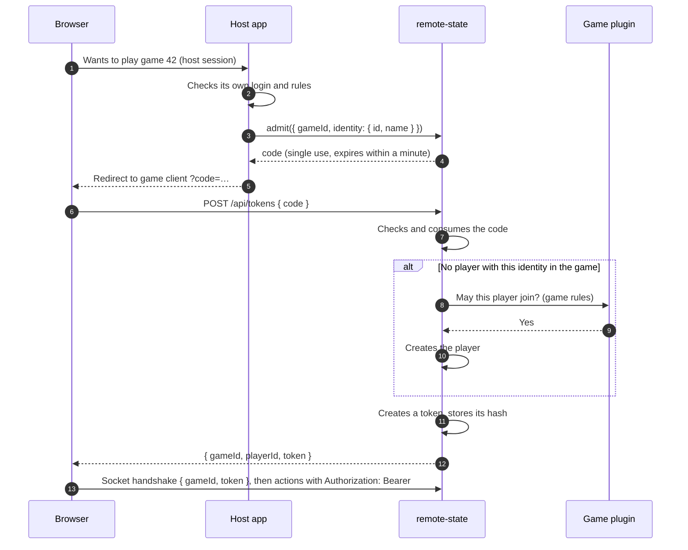

# Authorization

Status: Open

## Problem

The library knows *who* is acting, through per-player tokens, but decides very little about *what* they may do. Today:

- **Identity is per game.** Creating a game or registering for one issues a player ID and a random 64-character token. The same person in two games is two unrelated players.
- **Anyone can create a game.** `POST /api/games` requires nothing.
- **Anyone who knows a game's ID can join it.** `POST /api/games/:gameId/players` requires nothing, and the game logic isn't asked.
- **The token is the only credential.** It never expires, can't be revoked or reissued, and is stored in the database in plain text, so anyone who can read the database can act as any player.
- **Tokens travel in two places.** Actions accept a bearer header or a `token` field in the body; reads and the socket accept only the header or handshake.
- **Roles mean nothing yet.** The game's creator gets the `admin` role, but no endpoint checks it.
- **What a player may do in the game is up to the game.** `validateAction` enforces turns and rules. The library only checks that the player belongs to the game.
- **Operational endpoints are open.** `POST /admin/log-level` is unauthenticated unless `NODE_ENV=production`, and nothing is rate-limited.

This is a library that runs inside someone else's server ([Goals](../goals.md)). That server usually has its own users and login, which the library currently ignores.

## Constraints

- **The host application usually owns user identity.** The library shouldn't require its own accounts, passwords or sessions.
- **Game rules stay in the game.** Whether a move is allowed on this turn is the game's decision, through `validateAction`.
- **Every channel needs the same answer.** HTTP actions, HTTP reads and the socket must authenticate the same way and agree on who is who.
- **Hidden information depends on it.** Each player's view is filtered for that player ([0010](../decisions/0010-every-game-has-hidden-information.md)), so being able to act as another player means seeing their hidden information.

## Proposal: admitting players

The host decides who may play; the library issues and checks tokens ([0016](../decisions/0016-authentication-in-library-authorization-by-implementer.md)). Between the two, the host *admits* a person to a game, and the library turns that into a token, handed over through a single-use code.

1. **The host admits.** After its own login and checks, the host calls `admit` on the server object, in the same process ([0006](../decisions/0006-single-process.md)). It passes the game and an identity: an ID of its own choosing, which the library stores but never interprets, and details for the game such as a display name.
2. **The library returns a code.** The library generates it, so it controls its randomness, single use and expiry. The code expires within a minute, since it's redeemed right away.
3. **The browser carries the code.** A redirect between two apps can only carry data in the URL, so the code ends up in browser history and access logs. That's harmless once it's used or expired. The token itself never appears in a URL.
4. **The game client redeems the code** with a POST, with the code in the body rather than the path, and gets a token.
5. **The library finds or creates the player.** A player is identified by the game and the host's identity ID. The first time, the game's rules decide whether they may join, for example against a player limit. Afterwards, the same identity gets the same player back.
6. **Every redemption creates a new token** ([0019](../decisions/0019-several-tokens-per-player.md)). A second device, another browser or a lost token are all handled by admitting the person again.

What this settles:

- **Creating and joining games** (questions 2 and 3): the host's decisions happen in its own code, before `admit`, with its own login. The library needs no `canCreateGame` hook, and never has to understand the host's authentication. The game's rules on joining are a game hook.
- **Reissuing tokens** (question 5): admitting the same identity again.
- **Recognizing a person again:** within a game, through the identity ID. Across games, the host already knows its users.
- **Host details for the game:** passed with the identity.

Standalone use, as in the tutorial, keeps today's public endpoints for creating and joining games, which issue tokens directly. A host that controls access turns them off.

## Questions to decide

Authentication is the library's job, and authorization the implementer's ([0016](../decisions/0016-authentication-in-library-authorization-by-implementer.md)). Questions 2, 3, 4 and 6 are therefore no longer about the library's policy, but about where implementers can decide, and what the library tells them.

### 1. Where does identity come from?

Decided: **A**, the library issues its own opaque tokens ([0015](../decisions/0015-library-issues-opaque-tokens.md)).

- **A. Per-game tokens, as today.** Self-contained, and needs nothing from the host. But players can't be recognized across games, and the host's login is ignored.
- **B. The host authenticates, and the library maps users to players.** The host provides a function, for example `authenticate(request) → userId | null`, used on every HTTP request and socket handshake. The library links each player to a user. Players are then recognized across games and devices, and there's no separate token to lose.
- **C. Both.** Tokens by default, so the library works on its own, as in the tutorial. The host's authentication replaces them when configured.

### 2. Who may create a game?

Decided: the implementer ([0016](../decisions/0016-authentication-in-library-authorization-by-implementer.md)). Proposed: the host decides before admitting ([Admitting players](#proposal-admitting-players)), so no hook is needed.

- **A. Anyone,** as today.
- **B. Whoever the host allows,** through a hook, for example `canCreateGame(user, options)`.

### 3. Who may join a game?

Decided: the implementer, the game or the host ([0016](../decisions/0016-authentication-in-library-authorization-by-implementer.md)). Proposed: the host decides before admitting, and the game through a hook when a player is first created ([Admitting players](#proposal-admitting-players)). Invitations are the host's to build on top.

- **A. Anyone who knows the game's ID,** as today. The ID works like an unguessable invitation link.
- **B. The game decides,** through a hook asked on registration, for example to enforce a player limit. This overlaps with [Player information](player-information.md) and [Game lifecycle](game-lifecycle.md).
- **C. The host decides,** for example for private games, invitations or friend lists.
- **D. Separate invitation tokens,** issued by the game's admin and required to join.

### 4. What do roles mean?

Decided: **B**, the game defines them ([0016](../decisions/0016-authentication-in-library-authorization-by-implementer.md)). Open: whether the library keeps a `role` field for games to use, or leaves it to the game's state.

Candidates for what an `admin` could do: start or restart the game, remove players, change options, close or delete the game. Candidates for further roles: `spectator`, who sees but can't act; `moderator`.

- **A. The library defines roles and their powers.**
- **B. The game defines them.** The library only records roles, and passes them to the game, which checks them in `validateAction`.
- **C. Split.** The library enforces powers over the game session itself (removing players, deleting the game). The game decides what roles mean for its rules.

### 5. How are credentials handled?

Decided: tokens are stored hashed, and accepted only in the header and the handshake ([0017](../decisions/0017-hashed-tokens-in-header-and-handshake.md)). For now, they don't expire and can't be revoked ([0018](../decisions/0018-no-token-expiration-or-revocation.md)). A player can have several tokens ([0019](../decisions/0019-several-tokens-per-player.md)). Proposed: reissuing by admitting again ([Admitting players](#proposal-admitting-players)).

Independent of question 1, some improvements apply to any token:

- **Store tokens hashed.** Tokens are random and long, so a fast hash such as SHA-256 is enough. A database leak then no longer lets anyone act as a player.
- **Accept them in one place.** Only the `Authorization` header on HTTP, and the handshake on the socket; drop the body field.
- **Expiry, revocation and reissue.** For example: let a player replace a lost token, let an admin revoke a player's token, and expire tokens of finished games.

### 6. What protects the service itself?

Decided: rate limiting is the host's job ([0016](../decisions/0016-authentication-in-library-authorization-by-implementer.md)). Open: the library's own operational endpoints.

- **Operational endpoints,** such as `/admin/log-level`: remove them, or authenticate them through the host. Also listed in the [backlog](../../../BACKLOG.md).
- **Rate limiting,** at least for creating games and registering players, which today can be called without limit by anyone.
- **Whose job it is:** the library's, or the host's, for example with its own middleware in front of the library's routes.

## Open questions

- Can the host limit how many tokens a player has, for example to one ([0019](../decisions/0019-several-tokens-per-player.md))?
- How a game is created when a host controls access: a separate `createGame` call followed by `admit`, or `admit` creating the game when it's given none. Today, creating a game also creates its first player, with the `admin` role.
- What the game's join hook receives: the current state, the identity's details, the game's options.
- How public endpoints are turned on and off, and which is the default.
- Whether the library needs a server-to-server endpoint for `admit`, for hosts that don't run in the same process. Not while it runs as a single process ([0006](../decisions/0006-single-process.md)).
