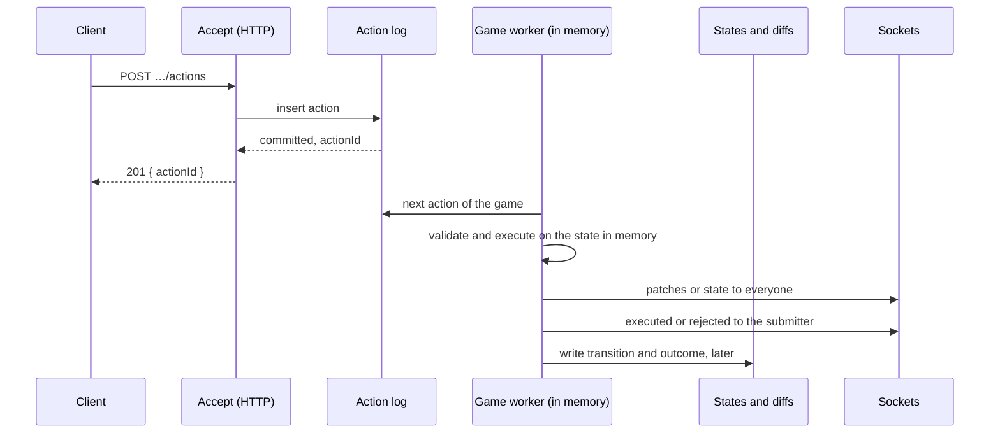

# Throughput and persistence

Status: Deferred until a game or host needs more throughput or lower latency than 0.6.0 offers. Explored with prototypes that were then discarded; their measurements are in [Performance measurements](../../reference/performance.md#2026-10-04-persistence-experiments-on-060).

## Problem

With 100 battleship games and players acting as fast as the server answers, one server handles about 100 actions per second, with an end-to-end p95 of 3–4 seconds. Its single thread is busy almost all of the time: the server process is CPU-bound, and requests wait for each other.

In version 0.6.0, every action:

1. looks up the player's token
2. reads the game's latest state and its players
3. validates and executes the action
4. computes three diffs: the full-state diff that's stored, and one per audience
5. writes the new state, the diffs and the player changes in one transaction, and waits for the commit
6. only then broadcasts and answers

That's about seven queries through MikroORM per action, and a sync to disk on every commit.

## Constraints

- One process owns its games ([0006](../decisions/0006-single-process.md)); multiple processes aren't a requirement yet.
- Clients only ever see states that the server will still have after a restart, unless a decision explicitly gives that up.
- Games don't have to be deterministic. A game may shuffle or roll dice inside `executeAction`.
- The history stays complete: every transition, with its diffs and author ([0013](../decisions/0013-store-full-state-diffs.md), [0039](../decisions/0039-actions-recorded-with-authors-audience.md)).

## What the experiments showed

- **Syncing to disk on every commit was the largest single cost.** WAL with `synchronous=NORMAL` gave about 50% more throughput and brought p95 from seconds to about 155 ms. `synchronous=OFF` added almost nothing on top.
- **Without any disk, the server reaches about 155–160 actions per second.** That's the ceiling of the current design: 6–7 ms of CPU per battleship action. About half of that is ORM work for the queries, about a fifth is diffing with rfc6902, and the library's own logic is a few percent.
- **JSON serialization is not significant:** a few percent in total.
- **The accept/execute split mainly improved latency** (p95 about 85 ms); throughput stayed near the ceiling, because it does the same work in a different order.

The options below are therefore of two kinds: storage settings, which remove waiting, and service changes, which remove work.

## Options

### A. WAL with `synchronous=NORMAL`

Set when the database opens. No API change.

- The largest gain for the smallest change.
- Changes the durability promise: a crash of the server process loses nothing that was committed, but an operating system crash or a power loss can lose the last commits. That needs a decision record.
- It's SQLite-specific. Another database would have its own equivalent.

### B. Keep each game's data in memory

Keep the latest state, the players and their audiences, and the token-to-player mapping in memory, so an action reads nothing from the database.

- **Memory:** a battleship state is about 1.2 KB of JSON, so even thousands of games fit. The cache still needs a bound, by count or size, and eviction of idle games. Evicting costs nothing but a reload.
- **Wrong game:** keep caches per server instance (per database), keyed by game ID. Check that the cached sequence is the stored one before writing; the unique constraint on game and sequence stops a stale cache from overwriting.
- **Mutation:** today a game gets a fresh state from the database for every action, so mutating it does no harm. A cached state would be corrupted. Freeze cached states, or copy them before handing them to the game.
- **Only safe with one process per game.** A second process writing to the same game would make the cache stale.

### C. Write and compute less per action

- The full-state diff was stored but never sent to clients. It's now computed only when needed, from the stored states ([0050](../decisions/0050-full-state-diffs-derived-not-stored.md)).
- The per-audience diffs only serve `GET …/updates`. They could be built from stored states on demand, or kept in memory for recent sequences only.
- A faster established diff library, or games that produce patches themselves with Immer's `produceWithPatches`, would make the remaining diffs cheaper.
- Writing fewer rows, or writing them without the ORM's unit of work, reduces the ORM's share.

### D. Group commit

Write all transitions that are ready in one transaction, and answer each request once its batch is committed.

- About 16% more throughput on top of A and B.
- Raises p50, since every action waits for its batch.
- Without A, it doesn't fix the tail latencies.
- One failing transition fails its whole batch, unless failures are isolated, for example by retrying the others.

### E. Split accepting from executing

Accept writes the action to the log before answering. Execute works in memory, answers over the socket, and writes afterwards.

**Benefits**

- Requests never wait for another game's work, and execution never waits for a commit.
- The log is the queue: actions are executed in the order they were accepted, and accepted actions survive a crash.
- A slow `executeAction`, such as a host's computer player, doesn't hold up requests.

**Costs**

- **API changes:**
  - `POST …/actions` answers `201 { actionId }` instead of `{ sequence }`.
  - Rejections that depend on the state arrive later, as a `rejected` event, instead of a 400.
  - Clients that poll need `GET …/actions/:actionId`.
  - The host's `act` changes the same way.
- **Accept has to commit before answering,** so it needs A, or group commit for the log. With SQLite's default journal, the prototype was slower than 0.6.0.
- **Crash recovery:** actions logged without an outcome are executed again at startup. Results that were broadcast but not yet written can turn out differently on replay, unless `executeAction` is deterministic. Either broadcast only after writing, or require determinism, or resend the full state after a restart.
- **Reads:** `GET …/state`, `GET …/updates` and new sockets have to read from memory, or wait for pending writes, to agree with what was broadcast.
- **Timers** have to append to the log, like the host's `act`, instead of running directly.
- **Two validation moments:** a cheap accept check, and full validation at execution. Games would need an optional accept hook, so that `validateAction` isn't called against two different states.

## Open questions

- Which latency and throughput targets matter, for which kinds of games? Turn-based games at human speed are well within 0.6.0's numbers. Realtime games aren't.
- Is losing the last commits on a power loss acceptable (A)?
- Must replay after a crash reproduce what clients saw (E), or is a fresh full state enough?
