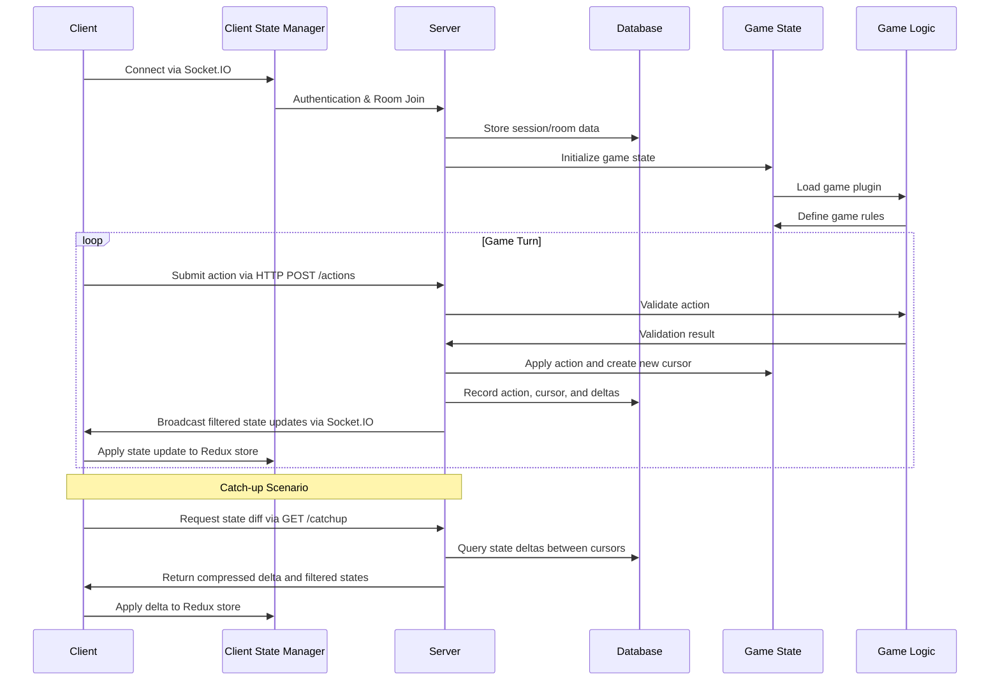
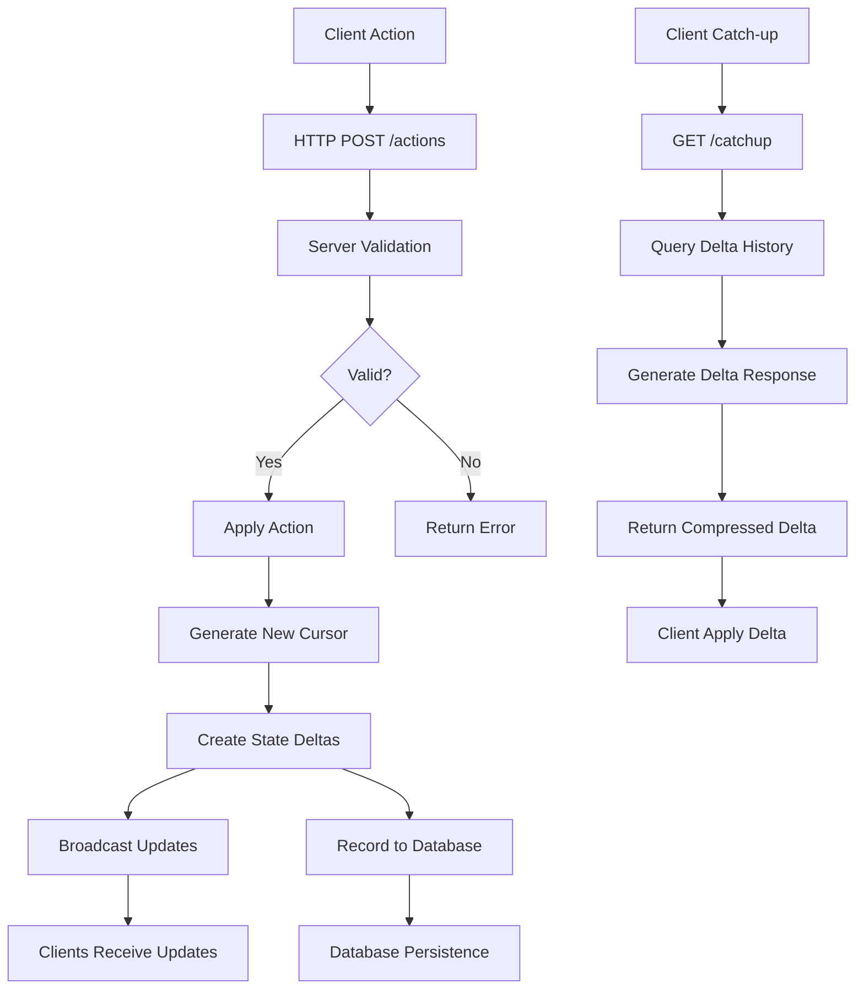

# Remote State - Multiplayer Game Infrastructure Library

## Library Name

**@malte.muth/remote-state**

A TypeScript-based multiplayer game **infrastructure library** that provides state management, real-time synchronization, and communication primitives for turn-based games. This library manages deltas, cursors, endpoints, and data channels, but does not contain any actual game logic.

## Project Structure

The project will be organized as an npm workspace with 4 main packages:

1. **@malte.muth/remote-state** - Core server package handling state management, communication, and infrastructure
2. **@malte.muth/remote-state-client** - Client package with state management and connection handling
3. **@malte.muth/remote-state-example-server** - Example implementation demonstrating game hosting
4. **@malte.muth/remote-state-example-client** - Example client showing integration patterns

Each package will have its own TypeScript configuration and dependencies, with shared ESLint configuration at the workspace root.

## Core Architecture

### 1. Communication Protocol

- **Express HTTP API**:
  - State retrieval via cursors for synchronization
  - Action submission endpoint
  - Administrative tasks and authentication
- **Socket.IO**:
  - Real-time game state updates and subscriptions
  - Live game state broadcasts
- **Dual Protocol**: Clients use both for optimal performance and reliability

### 2. State Management System

- **Server-side Redux Architecture**: Server manages game state with actions, reducers, and selectors
- **Redux Middleware**: Client library integrates with existing Redux stores as middleware
- **State Filtering**: Each client receives filtered view based on role (player/spectator/admin)
- **Real-time Synchronization**: Automatic state updates via WebSocket connections
- **Cursor-based Tracking**: Each player maintains a position in the game state timeline

### 3. Database Layer

- **SQLite**: Embedded database for state persistence
- **Schema Design**: Games, players, rooms, and state history
- **Restart Recovery**: State restoration after server restart
- **Action Recording**: Complete audit trail of all actions, cursors, and deltas

### 4. Plugin Architecture

- **Game Plugin Interface**: Standard contract for game logic validation
- **Dynamic Loading**: Runtime plugin loading without server restart
- **Extensibility**: Support for different game types and rules
- **Validation Only**: Library only validates actions, does not implement game logic

## Implementation Plan

### Phase 1: Project Setup

1. **Create npm workspace structure** with 4 packages
2. **Configure TypeScript** for all packages with strict typing
3. **Set up ESLint** for consistent code quality across packages

### Phase 2: Core Server Implementation

4. **Database Layer**: SQLite integration with schema design
5. **Express HTTP API**: REST endpoints for game management and state sync
6. **Socket.IO Integration**: Real-time WebSocket communication

### Phase 3: Client Implementation

7. **State Management**: Redux-like client state system
8. **Connection Handling**: HTTP + Socket.IO client integration

### Phase 4: Plugin System

9. **Game Interface**: Define plugin contracts and interfaces
10. **Dynamic Loading**: Implement plugin loading mechanism

### Phase 5: Examples & Documentation

11. **Example Server**: Demonstrate game hosting with Tic-Tac-Toe
12. **Example Client**: Show React integration patterns
13. **Documentation**: Comprehensive guides and API docs

## Technology Stack

### Core Dependencies

- **Runtime**: Node.js (server), Browser/React (client)
- **Database**: SQLite with better-sqlite3 for performance
- **HTTP Server**: Express.js
- **WebSocket**: Socket.IO with fallbacks
- **State Management**: Custom Redux-like implementation
- **Cursor-based Updates**: Efficient state diffing with cursors and deltas
- **Delta Compression**: Only send changed state portions to minimize bandwidth
- **Type Safety**: TypeScript with strict configuration
- **Code Quality**: ESLint + Prettier

### Development Tools

- **Build System**: Turborepo or Nx for monorepo management
- **Testing**: Jest + React Testing Library
- **Linting**: ESLint with TypeScript support
- **Formatting**: Prettier for consistent code style

## Key Interfaces

### Game Plugin Interface

```typescript
interface GamePlugin<TGameState extends GameState = GameState> {
  name: string;
  version: string;
  minPlayers: number;
  maxPlayers: number;

  initialState: TGameState;

  validateAction(state: TGameState, action: PlayerAction): ValidationResult;
  applyAction(state: TGameState, action: PlayerAction): TGameState;
  checkWinCondition(state: TGameState): WinCondition | null;

  onPlayerJoin?(state: TGameState, player: Player): TGameState;
  onPlayerLeave?(state: TGameState, player: Player): TGameState;
  onGameStart?(state: TGameState): TGameState;
  onGameEnd?(state: TGameState): TGameState;
}
```

### Cursor and Action System

```typescript
interface Cursor {
  id: string;
  playerId: string;
  gameId: string;
  timestamp: number;
  stateHash: string;
  position: number;
}

interface ActionRecord {
  id: string;
  gameId: string;
  playerId: string;
  action: PlayerAction;
  cursor: Cursor;
  timestamp: number;
  validationResult: ValidationResult;
}

interface StateDelta {
  fromCursor: Cursor;
  toCursor: Cursor;
  changes: StateChange[];
  compressed: boolean;
}

interface StateChange {
  path: string[];
  oldValue: any;
  newValue: any;
  operation: "add" | "update" | "delete";
}
```

### Client Communication Flow

1. **Action Submission**: Client sends action via HTTP endpoint
2. **Server Validation**: Server validates action using game plugin
3. **State Update**: Server applies action and creates new cursor
4. **Delta Generation**: Server creates state deltas for all affected players
5. **Broadcast**: Server broadcasts filtered state updates via Socket.IO
6. **Recording**: Server records action, cursor, and deltas in database
7. **Synchronization**: Clients can request state diffs between cursors via HTTP

### Catch-up Mechanism

```typescript
interface CatchupRequest {
  gameId: string;
  playerId: string;
  fromCursor: string;
  toCursor: string;
}

interface CatchupResponse {
  gameId: string;
  playerId: string;
  delta: StateDelta;
  filteredStates: Record<string, FilteredState>;
}
```

## Data Flow Architecture



## Action Processing Flow



### Redux Middleware Interface

```typescript
interface RemoteStateMiddleware {
  middleware: Middleware<{}, GameState>;
  actions: {
    submitAction: (action: GameAction, cursor: Cursor) => Promise<void>;
    catchup: (
      gameId: string,
      fromCursor: string,
      toCursor: string
    ) => Promise<StateDelta>;
    subscribe: (gameId: string) => void;
    unsubscribe: (gameId: string) => void;
  };
  selectors: {
    getGameState: (state: RootState, gameId: string) => GameState;
    getCursor: (state: RootState, gameId: string) => Cursor | null;
    getGameStatus: (state: RootState, gameId: string) => GameStatus;
  };
}
```

## API Endpoints

### HTTP Endpoints

#### Action Submission

```http
POST /api/games/{gameId}/actions
Content-Type: application/json

{
  "action": {
    "type": "MAKE_MOVE",
    "payload": { "row": 0, "col": 0 }
  },
  "cursor": "cursor-123"
}
```

#### State Retrieval

```http
GET /api/games/{gameId}/state?cursor=cursor-123
```

#### Catch-up Request

```http
GET /api/games/{gameId}/catchup?fromCursor=cursor-123&toCursor=cursor-456
```

#### Current State

```http
GET /api/games/{gameId}/state/current
```

### WebSocket Events

#### Client → Server

- `action`: Submit player action
- `subscribe`: Subscribe to game state updates
- `catchup-request`: Request state delta

#### Server → Client

- `state-update`: New game state with filtered view
- `action-confirmed`: Action processed successfully
- `action-rejected`: Action validation failed
- `player-joined`: New player joined game
- `player-left`: Player left game

## Example Usage

### Server Side

```typescript
import { RemoteStateServer } from "@malte.muth/remote-state";
import { TicTacToePlugin } from "./games/TicTacToe";

const server = new RemoteStateServer({
  port: 3000,
  database: "./games.sqlite",
  plugins: [new TicTacToePlugin()],
});

server.start();
```

### Client Side (Redux Integration)

```typescript
import { remoteStateMiddleware } from "@malte.muth/remote-state-client";
import { createStore, applyMiddleware } from "redux";
import rootReducer from "./reducers";

// Configure Redux store with remote-state middleware
const store = createStore(
  rootReducer,
  applyMiddleware(remoteStateMiddleware.middleware)
);

// Action creators
const { submitAction, catchup, subscribe, unsubscribe } =
  remoteStateMiddleware.actions;

// Selectors
const { getGameState, getCursor, getGameStatus } =
  remoteStateMiddleware.selectors;

// Component usage
function GameComponent() {
  const gameState = useSelector((state) => getGameState(state, "room-123"));
  const cursor = useSelector((state) => getCursor(state, "room-123"));
  const dispatch = useDispatch();

  function handleCellClick(row: number, col: number) {
    dispatch(
      submitAction({ type: "MAKE_MOVE", payload: { row, col } }, cursor)
    );
  }

  // Catch up if connection was lost
  function handleReconnect() {
    dispatch(catchup("room-123", lastCursor, currentCursor)).then((delta) => {
      // Redux store will be updated automatically
    });
  }

  return <div>{/* Game UI using gameState from Redux store */}</div>;
}
```

## Security Considerations

- **Player Authentication**: Session-based authentication with JWT tokens
- **Action Validation**: Server-side validation of all player actions
- **State Filtering**: Prevent information leakage between players
- **Rate Limiting**: Prevent spam and cheating through action rate limiting
- **Input Sanitization**: Validation and sanitization of all communications

## Performance Optimizations

- **State Diffing**: Only send changed state portions to clients
- **Connection Pooling**: Efficient WebSocket connection management
- **Database Indexing**: Proper indexing for frequent queries
- **Caching**: Redis caching for frequently accessed game states
- **Load Balancing**: Support for multiple server instances

## Success Criteria

1. **Infrastructure Focus**: Library provides only infrastructure, no game logic
2. **Extensibility**: Easy to integrate with any turn-based game
3. **Performance**: Real-time state updates with minimal latency
4. **Scalability**: Support for multiple concurrent games
5. **Developer Experience**: TypeScript support, clear APIs, good documentation
6. **Reliability**: State persistence, connection resilience, error handling
7. **Security**: Proper authentication, validation, and state filtering

## Key Differentiators

- **Infrastructure Only**: Manages state, communication, and synchronization - not game rules
- **Cursor-based State**: Each player tracks their position in the game timeline
- **Delta Compression**: Efficient bandwidth usage through state diffing
- **Plugin Validation**: External plugins handle action validation only
- **Catch-up Mechanism**: Seamless reconnection with delta-based state sync

This architecture provides a solid foundation for building turn-based multiplayer games by handling all the infrastructure concerns while leaving game logic to external implementations.
